# correlation

<p align="center">
  
</p>
<p align="center"><sub>Three identical triple pendulums, started a billionth of a radian apart. <a href="pendulum/README.md">Why this is the answer</a>.</sub></p>

20-something years ago a group of friends sat in a coffee shop. We were fresh out of college and had our first "real" jobs, and we were thinking about how we could get rich. I had an idea at the time that seemed obvious: basically a simple way to slightly improve the odds of predicting stock market moves. Of course, the prevailing wisdom was that this had been [attempted many times](experiments/prior-work.md) and proven to not be possible. But then we had to wonder, if it ever did work, why would they tell anyone? They would just quietly use it themselves and get rich. So without trying it, we would never really know.

The core idea was this: if companies are related by market conditions, and company A were to go up or down in value over some period, then might not other companies do the same at a later date? Like if there was a RAM shortage, surely it would affect a lot of companies. But it should affect some (perhaps the smaller ones) before it affected the larger ones. If we could calculate a mathematical correlation across every company, and perhaps even other conditions such as political or weather patterns, then we should be able to say, "A went up, so there is a 3% chance that in 4 months B will also go up"... or something like that.

Of course, the number of calculations on the whole stock market over all offsets, using different time windows to measure up and down, was somewhere in the range of 1.5 trillion. That was going to take perhaps years on a whole room full of Pentium IIs, so it was quite an investment to find out.

A few of us were programmers, so we actually made a start on it in the early 2000s. At the time it turned out to be fairly hard, and we were all kind of busy, so each attempt kind of fizzled. But computers got faster, and with the advent of AI the programming got a lot easier. About a year ago I (with Claude 4.0) wished into existence [a proof of concept](correlation-original/README.md) and discovered that even on a 24-core modern desktop, in Ruby, the correlation would take about 15 years. So I changed the core calculation to inline C, and found that it would take about 6 months of listening to my fans spin furiously with all my CPU maxed out constantly. Having other things to use the computer for, I gave up after a few days.

Last week I decided to try the whole thing again [in Rust](SPEC.md) (using Claude 5.5). This time it would max out every core I had: all the CPUs, all the GPU, and even the tiny NPU that came with this desktop for some reason. I was kind of shocked to find that [all the calculations](experiments/+2.0-correlation-census.md) now take a total of 17 minutes. So I waited 17 minutes.

And discovered that [the skeptics were right all along](experiments/prior-work.md). Correlations were found, but they were so small and inconsistent that using them to trade would basically be [the same as choosing stocks at random](experiments/-11.4-census-picks.md). Not ready to give up quite yet, though (because another idea had emerged in my fevered mind), I thought, "If an LLM trained on words can predict the next word, perhaps one trained on stocks could predict the next stock?" So [I tried that](stockai/README.md) and [it also failed](experiments/-19.8-stockgpt-next-day.md).

Still not ready to give up, I tried [about 70 other variations](experiments/README.md) on those ideas. And at this point I am ready to admit that this 20-year-long question is finally resolved. Unfortunately for me, I will not be getting rich.

In retrospect, I think I now understand why it will never work. It can be explained by a [triple pendulum](pendulum/README.md). Correlation can add some accuracy to the swing of the first pendulum, but there is another attached to that, which is people making bets, buying and selling, markets moving faster than I can react. Then there is a third attached to that: outside influences that are not measured. The result, unfortunately, is the incarnation of chaos.

But if you are anything like me and had a similar idea once in your misspent youth, and you are thinking that maybe there is something to it and I am just keeping it hidden so I can profit off it myself, I decided to offer this repo. It has [all the things I tried](experiments/README.md), [all the data I used](datasets/README.md), and with Claude or Codex, or whatever is to come, [you can run it yourself](#install-and-run) and test your own variations. I wish you luck... if you think of something, please let me know; it will be our secret :). If not, maybe I will save you years of wondering why it is not possible.

## What it's useful for

It doesn't predict prices; [74 experiments](experiments/README.md) say so. What it does well is measure, quickly and honestly, how stocks move *together*. That turns out to be useful, mostly for risk. Everything below is in the desktop app, `c2-gui`.

### Knowing what you actually own

The **Together** tab measures same-day co-movement, the part of correlation that is real and lasting:
- **Portfolio check:** how many independent bets your holdings really are, each holding's share of the risk, near-duplicates, and how the correlations compare with a year earlier.
- **Best diversifiers:** what to add to lower your portfolio's volatility.
- **Hedge finder:** the stocks and funds that track or offset a holding, with hedge ratios and the risk left after each.
- **Groups map:** which stocks move together once the market is taken out, each group named by the fund that follows it, and how much of each group held together a year earlier.

This advice was tested on the following year it had never seen. The top diversifier cut a portfolio's volatility by 5.1% more than random choices, and the top hedge left 68% of a stock's risk against 91% for a random fund ([`+5.1-co-movement-tools`](experiments/+5.1-co-movement-tools.md)). Building a whole portfolio from correlations (minimum variance) gave a quarter to a third less risk than ignoring them in every period tested. In 2008 it fell 36% against 52% ([`-4.6-correlation-portfolios`](experiments/-4.6-correlation-portfolios.md)).

<table>
<tr><td>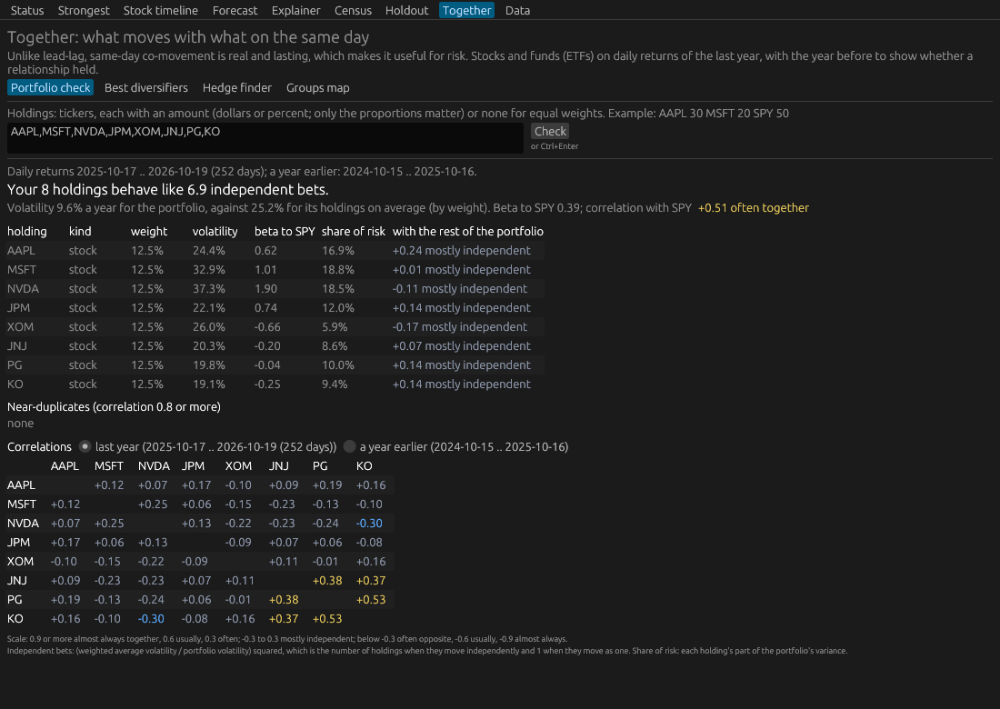</td><td>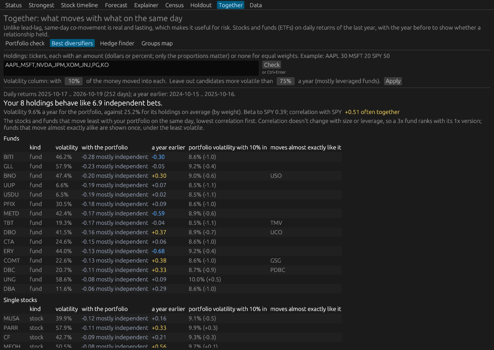</td></tr>
<tr><td align="center"><sub>Portfolio check: eight holdings behave like 6.9 independent bets</sub></td><td align="center"><sub>Best diversifiers: what to add, and how much risk it removes</sub></td></tr>
<tr><td>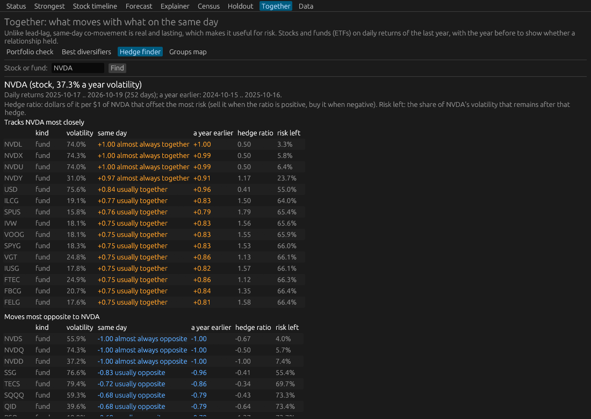</td><td>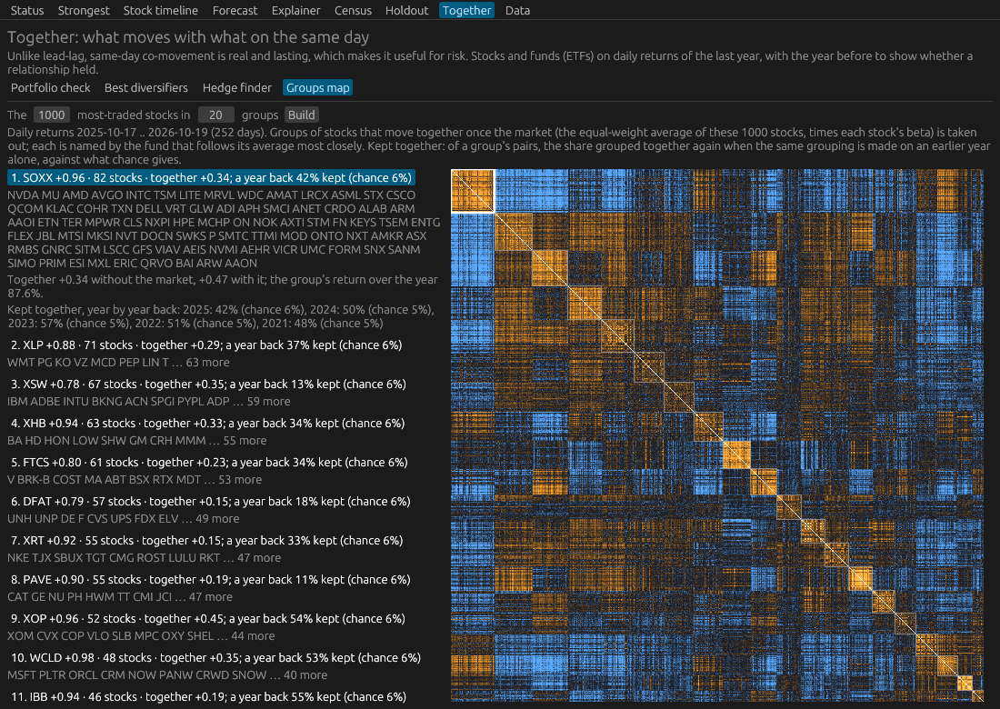</td></tr>
<tr><td align="center"><sub>Hedge finder: what tracks or offsets NVDA, and the risk left</sub></td><td align="center"><sub>Groups map: 1,000 stocks in groups that move together</sub></td></tr>
</table>

### Exploring relationships, with chance as the yardstick

Every relationship the app shows is set against what chance produces. Each one comes with the number of times it would appear by luck, so you can see which ones are real.
- **Strongest** ranks the strongest lead-lag relationships.
- **Stock timeline** shows what tends to move before a stock, and how often each relationship held.
- **Explainer** recomputes one correlation step by step from prices, so nothing is a black box.
- **Forecast** turns the relationships into a forecast and then grades it on its own history. For AAPL it says the direction was right 54% of the time, about a coin flip, "so treat the forecast line as noise". Most tools would just draw the line.

<table>
<tr><td>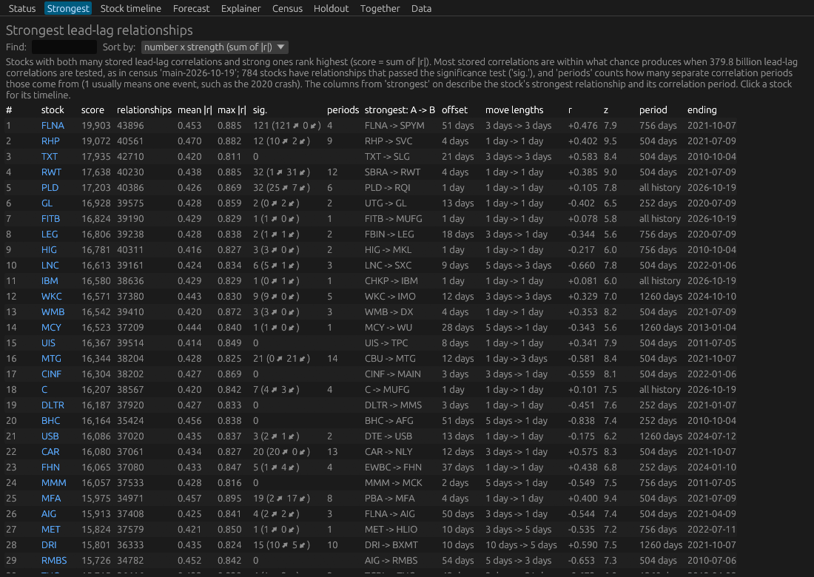</td><td>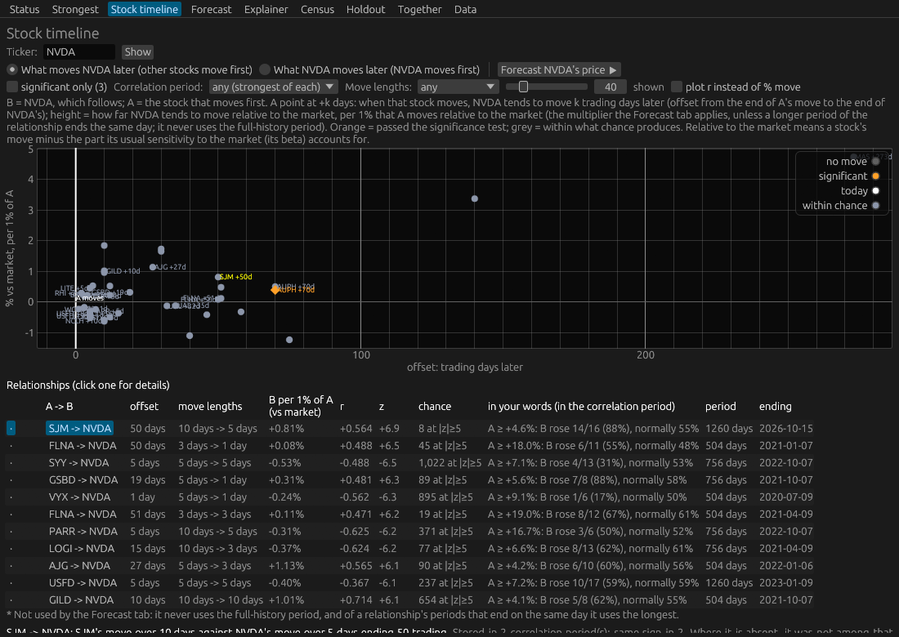</td></tr>
<tr><td align="center"><sub>Strongest relationships, with their significance</sub></td><td align="center"><sub>Stock timeline: what moves before NVDA</sub></td></tr>
<tr><td>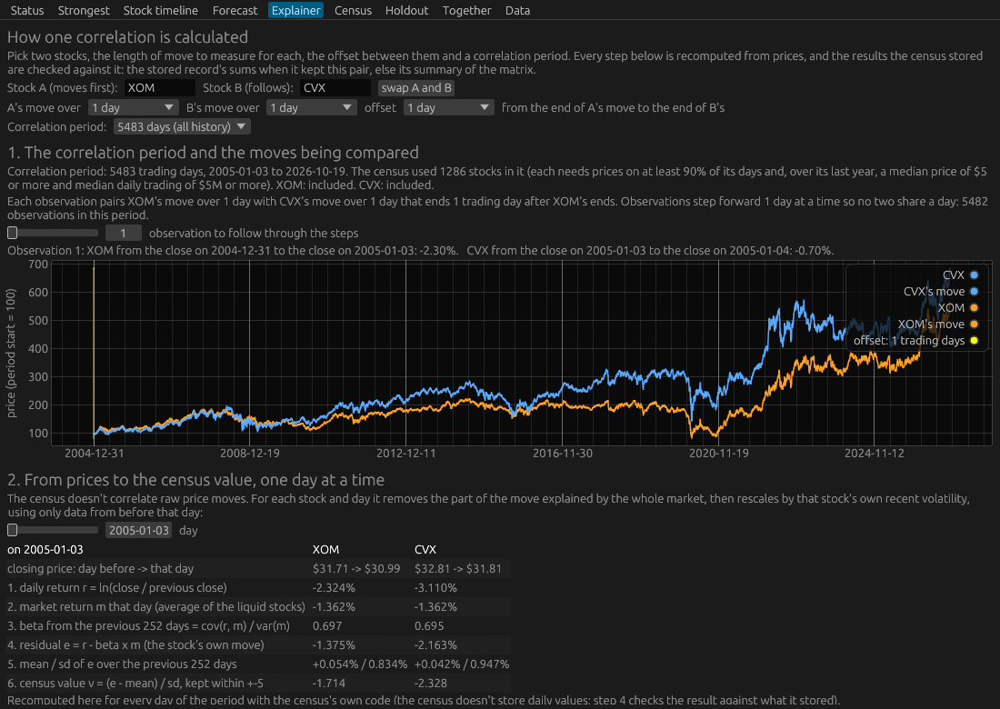</td><td>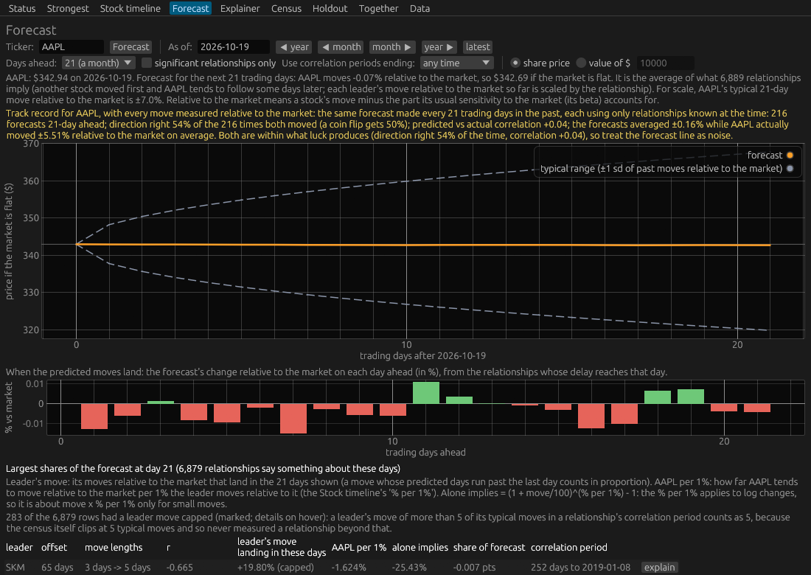</td></tr>
<tr><td align="center"><sub>Explainer: one correlation, step by step</sub></td><td align="center"><sub>Forecast, graded on its own history</sub></td></tr>
</table>

### Testing your own idea without fooling yourself

The hard part of testing a trading idea isn't the idea; it's not fooling yourself. This repo has the machinery:
- **A grader** that compares any strategy with random accounts holding as many stocks and trading as often.
- **Walk-forward tests,** plus 16 months of data kept unseen until the end.
- **Rules fixed before results,** a habit every one of the 75 [experiment write-ups](experiments/README.md) follows. Copy one as a template, and see [`research/lib/c2eval.py`](research/lib/c2eval.py) for the grader.
- **The census** computes every lagged correlation among every pair of US stocks: 1.57 trillion correlations in about 13 minutes on one desktop GPU. Its chance baseline comes from sign-shuffled data.

<table>
<tr><td>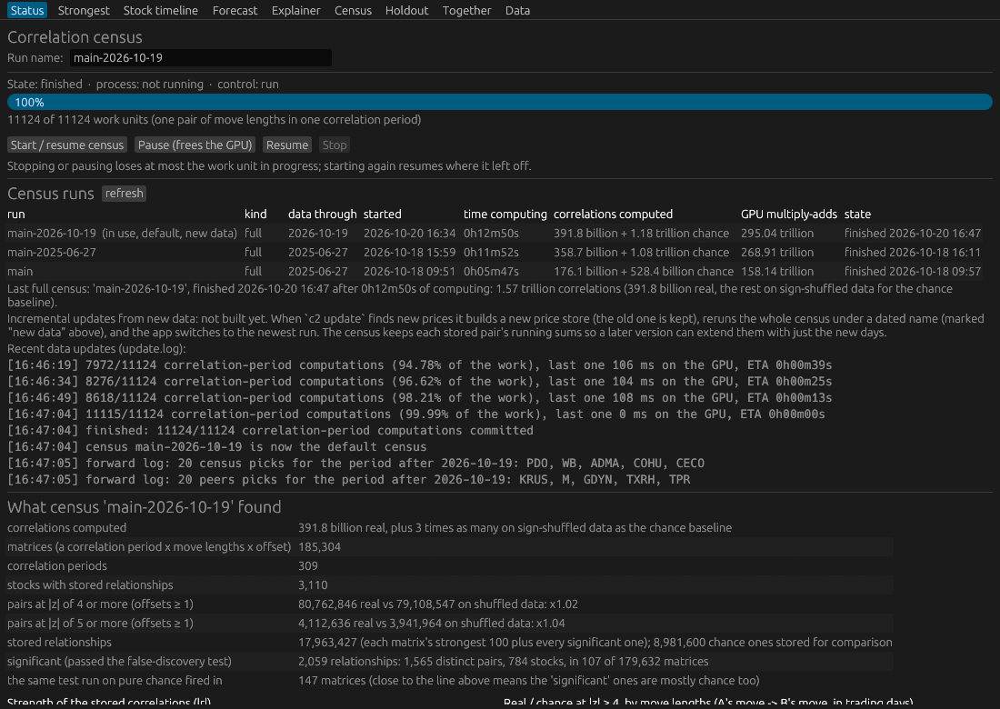</td><td>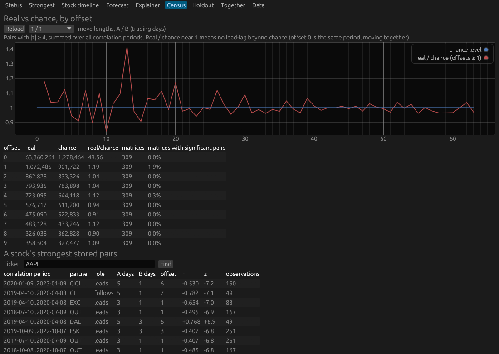</td></tr>
<tr><td align="center"><sub>Status: a full census, 1.57 trillion correlations</sub></td><td align="center"><sub>Census: lagged pairs against chance, about 1.0 at every offset</sub></td></tr>
<tr><td>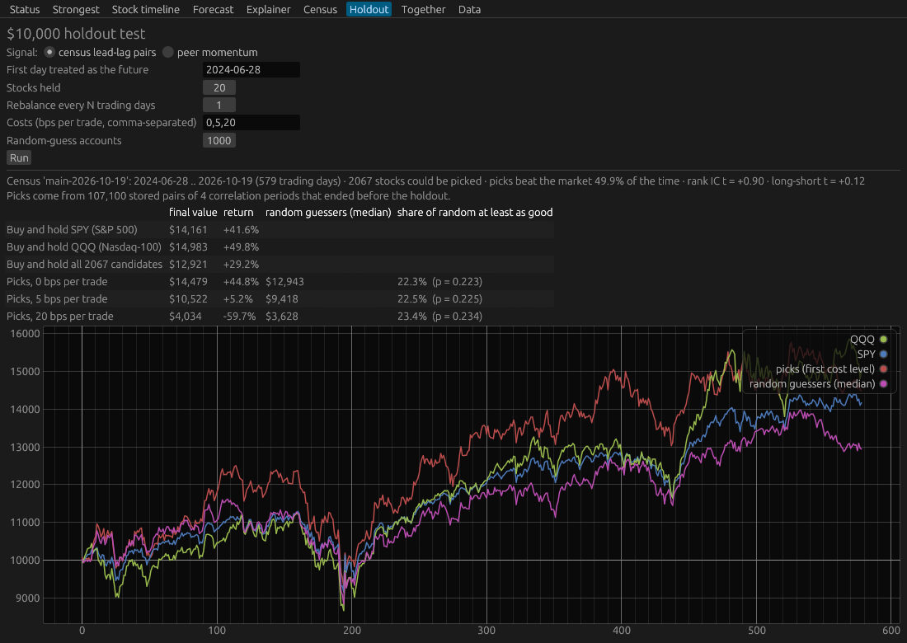</td><td>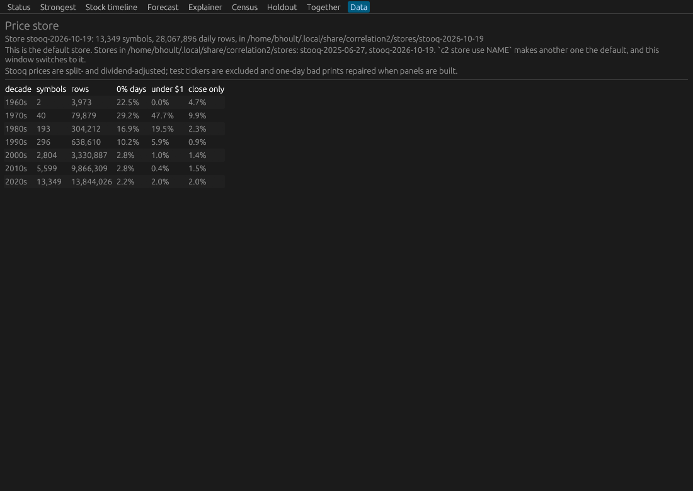</td></tr>
<tr><td align="center"><sub>Holdout: $10,000 against random guessers. +44.8% before costs, +5.2% at 5 bps a trade, −59.7% at 20 bps</sub></td><td align="center"><sub>Data: 13,349 stocks and funds, 28 million daily rows</sub></td></tr>
</table>

### Fast correlation, for anything

The engine computes all-pairs correlations with INT8 matrix multiplication on the GPU (cuBLASLt) or AVX-VNNI on the CPU (`crates/c2-engine`). Nothing in it is specific to stocks, so it works for any large set of time series.

### Learning why the obvious idea fails

[The triple pendulum](pendulum/README.md), [what others have tried](experiments/prior-work.md), and the experiments themselves, which include ten of the best-documented published strategies, retested on the years after their papers.

---

**TL;DR:** Can correlations between stocks, or with outside data like weather and news, predict where US stocks go next? After 74 tests on two decades of prices, no: nothing makes money reliably after trading costs. Correlation describes how stocks move together on the same day. That's real and useful for managing risk, but it doesn't say where anything goes next. One lead is still open, and it needs better data to settle.

| Question | Answer | Details |
|---|---|---|
| When stock A moves, does B follow later? | No. Lagged correlations turn up at the rate chance produces, at every delay and move length tried | [census](experiments/+2.0-correlation-census.md), [trading it](experiments/-11.4-census-picks.md) |
| Can machine learning, or a GPT trained on stock moves, do better? | They find real signals before costs, but trade so often that costs eat them | [LightGBM](experiments/+5.8-lightgbm-next-day-actual-returns.md), [stockGPT](experiments/-19.8-stockgpt-next-day.md) |
| Does outside data lead stocks? | No: none of 1,753 series (weather, news, prediction markets, the economy) | [outside data](experiments/+4.0-outside-data-leaders.md) |
| What about other ideas, new or published? | 50 more were tested, including ten well-known published strategies. None passed. The published ones mostly worked until they were published | [all experiments](experiments/README.md), [turn of the month](experiments/-9.6-turn-of-month.md) |
| Is anything still open? | A model's monthly top-10 picks beat SPY after costs, but the data includes only companies that survived. A stress test says data with delisted companies is worth buying to settle it | [monthly picks](experiments/+18.6-monthly-top10-picks.md) |
| What does work? | Same-day co-movement, for risk. Its advice beat random choices out of sample, and portfolios built from correlations carried a quarter to a third less risk | [co-movement tools](experiments/+5.1-co-movement-tools.md), [portfolios](experiments/-4.6-correlation-portfolios.md) |

The repo holds three generations of the project:
- **correlation v1** (`correlation-original/`): the 2025 Rails app.
- **correlation2** (the Rust code at the top level): a GPU census of every lagged correlation, a $10,000 test against random guessers, and the GUI.
- **stockai** (`stockai/`): Python machine-learning models graded by that test.

Every experiment, named by its result after costs, is in [`experiments/`](experiments/README.md).

## Start here

| Read | For |
|---|---|
| [`experiments/README.md`](experiments/README.md) | Every experiment tried, one file each, named by how much it beat random; plus lessons and what's still open |
| [`experiments/prior-work.md`](experiments/prior-work.md) | What others have tried, and what happened to it |
| [`pendulum/README.md`](pendulum/README.md) | Why none of it predicts: the triple pendulum, with an animation |
| [`test-results.md`](test-results.md) | correlation2's full running log of measurements and choices ("Where things stand" at the top) |
| [`ANALYSIS.md`](ANALYSIS.md) | The review of v1, its data, and the first honest test of its idea |
| [`SPEC.md`](SPEC.md) | The plan correlation2 was built from |
| [`stockai/README.md`](stockai/README.md), [`stockai/PLAN.md`](stockai/PLAN.md) | stockai's status and plan; its results are in `stockai/test-results*.md` |

## What's in this folder

| Path | What |
|---|---|
| `crates/c2-data` | Stooq zip → memory-mapped price stores (one per download) |
| `crates/c2-engine` | All-pairs correlations: cuBLASLt INT8 on the GPU, an AVX-VNNI kernel on the CPU |
| `crates/c2-census` | The census, the $10,000 holdout harness, the signal families (census pairs, peers, reversal, clusters), forecasts, the co-movement tools (`together.rs`) |
| `crates/c2-cli` | The `c2` command |
| `crates/c2-gui` | `c2-gui` (eframe/egui): Status, Census, Holdout, Data, Strongest, Stock timeline, Forecast, Explainer and Together tabs |
| `research/` | Scripts and raw outputs behind the numbers in `test-results.md` and `experiments/`; one folder per experiment run on 2026-10-21 |
| `research/lib/c2eval.py` | The shared grader for new experiments: loads the exports and the store, and grades a scores file with stockai's judge (correlation2's $10,000 harness, bit-identical). `change_over_random` gives the number in an experiment's file name |
| `experiments/` | One file per experiment tried, and the prior-work survey |
| `datasets/` | The raw data: both price stores (compressed, rebuilt by `datasets/unpack.sh`) and the 1,753 outside series ([`datasets/README.md`](datasets/README.md)) |
| `pendulum/` | The triple-pendulum explanation and its animation |
| `correlation-original/` | correlation v1, the Rails 8 + PostgreSQL app (2025). Its database ran in Docker (`correlation-db`, port 5434) |
| `stockai/` | Python (uv) project: stockGPT, LightGBM baselines, the monthly/weekly/two-month tests. `stockai/judge/` is a pinned fork of correlation2's harness |
| `explainer-correlation2.html` | A standalone explainer page |

## Install and run

Written so that a person, or a coding assistant such as Claude Code or Codex, can follow it top to bottom. Every step ends with a check; stop at the first one that fails. Tested on Linux (x86-64) with bash.

### 1. What you need

| Need | For | Notes |
|---|---|---|
| Rust 1.90 or later (`rustup`) | `c2`, `c2-gui` and the grader | |
| `zstd` | Unpacking the price data | `sudo apt install zstd` |
| Python 3 with numpy | The experiments in `research/` | The system Python is fine (tested with 3.14 and numpy 2.3); no other packages for most experiments |
| [`uv`](https://docs.astral.sh/uv/) | stockai's models (Python 3.12, torch, LightGBM), and the few experiments that keep their own environment | |
| NVIDIA GPU with a CUDA 13 driver | Optional: the census on the GPU, about 13 minutes on an RTX 5080 | Without one, everything runs on the CPU; the census is much slower |
| Node 18 or later | Optional: re-rendering the pendulum animation | |

**Disk:** about 3 GB for the data and builds. The tools keep their data in `~/.local/share/correlation2/`, a name from the Rust rebuild (correlation2) that the code expects; set `C2_DATA_DIR` to use another folder. Experiments write their large outputs to `~/.local/share/correlation2/experiments/`, which grows with each one you run.

### 2. Build

```
git clone https://github.com/bhoult/correlation.git
cd correlation
cargo build --release
mkdir -p ~/.local/bin && cp target/release/c2 target/release/c2-gui ~/.local/bin/
(cd stockai/judge && cargo build --release)
```

- The first build makes the command-line tool `c2` and the GUI `c2-gui`. The last line builds `stockai-judge`, the $10,000 grader every experiment uses.
- CUDA isn't needed to build: the GPU code loads it at run time and falls back to the CPU.
- **Check:** `c2 --help` prints the commands.

### 3. Install the data

```
datasets/unpack.sh
```

- It rebuilds both price stores from their compressed parts, verifies them against `SHA256SUMS`, and links them and the 1,753 outside series into `~/.local/share/correlation2/`. Set `$C2_DATA_DIR` first to use another folder.
- It is safe to run again. See [`datasets/README.md`](datasets/README.md).
- **Check:** `c2 store list` shows `stooq-2025-06-27` and `stooq-2026-10-19`.

### 4. Point the scripts at your clone

The experiment scripts name the folder this repo was built in, `/home/bhoult/programming/correlation`. If your clone is anywhere else, run this from the repo's root:

```
grep -rl /home/bhoult/programming/correlation research | xargs sed -i "s#/home/bhoult/programming/correlation#$PWD#g"
```

**Check:** `grep -rl /home/bhoult/programming/correlation research | wc -l` prints 0.

### 5. Set up the grader's data

The grader reads a price store from `$C2_DATA_DIR/store`, plus an export of prices and the census variable built from that store. `research/lib/c2eval.py` expects one of each per snapshot, in this layout:

```
for S in 2025-06-27 2026-10-19; do
  mkdir -p ~/.local/share/c2-sandbox-$S/store
  cp datasets/stocks/stooq-$S/prices.bin datasets/stocks/stooq-$S/symbols.tsv ~/.local/share/c2-sandbox-$S/store/
done
C2_DATA_DIR=~/.local/share/c2-sandbox-2025-06-27 stockai/judge/target/release/stockai-judge export --out ~/.local/share/correlation2/export/full
C2_DATA_DIR=~/.local/share/c2-sandbox-2026-10-19 stockai/judge/target/release/stockai-judge export
```

- Each export takes about a second.
- The first export covers prices through 2025-06-27; every walk-forward test uses it.
- The second covers prices through 2026-10-19; it is the "16 unseen months" each experiment uses once, at the end.
- **Check:** the `fingerprint` in `~/.local/share/correlation2/export/full/meta.json` is `8b5ac076267c83ab`, and in `~/.local/share/c2-sandbox-2026-10-19/export/full/meta.json` it is `5e2aaa6254c435e6`. Matching fingerprints mean your data is identical to the data every result here was computed on.

### 6. Check the whole chain

```
python3 -I -B research/betting_against_correlation/sanity_reversal.py
```

- This grades plain 5-day reversal through the same path every experiment uses, and takes a few seconds.
- **Check:** it prints `change over random +11.8 pts/yr` with `beat random at p<0.1 ... 8 ... of 18`. Any other number means something in steps 2–5 differs.

### 7. Use it

- **The GUI:** run `c2 census run` once (on the GPU, about 13 minutes; it resumes if stopped), then `c2-gui`. The Together tab's co-movement tools work without a census.
- **Rerun an experiment:** each file in [`experiments/`](experiments/README.md) has a "Files" section naming its scripts in `research/<name>/` and the order to run them.
- **Test your own idea:** write a score for every stock and day, using only data up to that day's close (higher means buy), and grade it against random accounts that trade as often:

  ```python
  import sys; sys.path.insert(0, 'research/lib'); import c2eval, numpy as np
  E = c2eval.load_export(c2eval.EXPORT_OLD, arrays=('close',))
  c = np.asarray(E['close'], dtype=np.float64)
  scores = np.full(c.shape, np.nan, np.float32)
  with np.errstate(all='ignore'):
      scores[:, 5:] = -np.log(c[:, 5:] / c[:, :-5])     # replace with your signal
  (c2eval.WORK / 'my_idea').mkdir(parents=True, exist_ok=True)
  report, js = c2eval.judge(c2eval.save_scores(scores, 'my_idea/reversal'), rebalance=5, random_match='uniform')
  print(c2eval.summary_line(js))
  ```

  - **Before costs:** `change_over_random(js)` gives the number the experiments compare against random.
  - **After costs:** for the number in the file names, see the scripts in `research/after_costs/`.
  - **The 16 unseen months:** grade them once, at the very end, with `export=c2eval.EXPORT_NEW, walk_forward=False, start='2025-06-30'`.
- **Memory:** some experiments need several GB. Run them under a cap so a runaway job can't take down the desktop:

  ```
  systemd-run --user --scope -p MemoryMax=8G -- python3 -I -B script.py
  ```

**For a coding assistant:**
- Run the steps in order, and stop at the first failed check.
- Never edit `datasets/` or an experiment's "Rules (fixed before looking at results)" section.
- Write new results to new files.
- The habits that kept these results honest are in [`experiments/README.md`](experiments/README.md) under "How new experiments are graded":
  - fix the rules before looking;
  - compare with random accounts that trade as often;
  - use the unseen months once;
  - report after costs.

### Everyday commands
| Command | What it does |
|---|---|
| `c2 store list` / `c2 store use NAME` | Price stores; pick the default |
| `c2 ingest ZIP` / `c2 update` | Build a store from a Stooq zip; `update` also reruns the census when needed and logs forward picks |
| `c2 census run --name NAME` | Run the census (about 13 minutes on the RTX 5080) |
| `c2 census holdout [--family census\|peers\|reversal\|clusters] [--walk-forward]` | The $10,000 test against turnover-matched random guessers |
| `c2 census clusters [--all-exchanges]` | Cluster lead-lag as Bennett et al. tested it |
| `c2 portfolio AAPL 30 MSFT 20 SPY 50`, `c2 diversify ...`, `c2 hedge XOM`, `c2 groups` | Same-day co-movement tools |
| `c2 forward-report` | Score the forward log's picks once their holding period has passed |
| `c2-gui` | The GUI |

**stockai** (from `stockai/`, after `uv sync`):

| Command | What it does |
|---|---|
| `scripts/poc.sh --quick` | stockGPT and the baselines on 2022–2023 (about 7 minutes) |
| `scripts/30d.sh [--horizon 5\|42]` | The monthly (or weekly, two-month) top-10 test |
| `uv run pytest -q` | Tests |

## Data

The raw data is in this repo: [`datasets/`](datasets/README.md) holds both price stores and the 1,753 outside series. After cloning, run `datasets/unpack.sh` once to rebuild the stores and link them where correlation2 looks. Everything else is derived and lives outside the repo:

| Where | What |
|---|---|
| `~/.local/share/correlation2/stores/<name>/` | Links to the price stores in `datasets/stocks/`: `stooq-2025-06-27` and `stooq-2026-10-19` (the default, named in `stores/CURRENT`) |
| `~/.local/share/correlation2/census/<run>/` | Census runs: `main`, `main-2025-06-27`, `main-2026-10-19` (the default, named in `census/LATEST`) |
| `~/.local/share/correlation2/external/` | Links to the outside series and catalogs in `datasets/external/`; the original downloads (`raw/`) and the outside-data correlation results (`results/`) stay here, out of git |
| `~/.local/share/correlation2/forward_log.jsonl` | Picks logged before their outcomes exist (first rows: 2026-10-19) |
| `~/.local/share/correlation2/inbox/` | Drop a new Stooq zip here for `c2 update`. Stooq needs a browser and CAPTCHA, so downloads are manual |
| `stockai/runs/` (about 60 GB) | stockai's scores, checkpoints and logs; not for git |
| `~/.local/share/correlation2/export/full/` | The judge's export of the census variable and prices through 2025-06-27, used for experiments' walk-forwards |
| `~/.local/share/c2-sandbox-2025-06-27/`, `~/.local/share/c2-sandbox-2026-10-19/` | Copies of the two price stores where the judge expects them, plus the export through 2026-10-19 used for the 16 unseen months. `research/lib/c2eval.py` points the judge at them |
| `~/.local/share/correlation2/experiments/<slug>/` (about 108 GB) | Large outputs (scores files, panels, the 10-K text) of the experiments run on 2026-10-21. Each experiment's scripts in `research/<slug>/` rebuild them, so they can be deleted |

## Open decisions

- **Survivorship-free data and fundamentals:** Stooq has only companies still listed, and no accounting data. Sharadar's price product ($39 for a month) includes delisted companies, which would settle stockai's one lead, the monthly picks (`experiments/+18.6-monthly-top10-picks.md`). The accounting-based published strategies, which have the best evidence and couldn't be tested here, need financial statements: Sharadar's separate fundamentals product, or SEC's free XBRL data, which needs requests to carry a contact email. The code is ready (`stockai/docs/sharadar.md`).
- **No untested ideas are left.** The open items are in `experiments/README.md` ("Still open"):
  - the Sharadar rerun above;
  - collecting the twin gap fade's opening-print effect, which needs paid pre-open imbalance data;
  - two checks that need a contact email for SEC downloads.
- **The weekday update timer** (`c2 install-timer --enable`) is off. The forward log only grows as new Stooq downloads come in.
- **Known open issues:**
  - the census's chance comparison is too lenient at 63-day moves;
  - the $5 price rule uses split-adjusted prices;
  - the bad-print repair looks one day ahead;
  - Stooq files a few funds as stocks.

## License

The code in this repo is free software under the GNU General Public License, version 3 or (at your option) any later version; see [`LICENSE`](LICENSE). That includes the earlier projects in `correlation-original/` and `stockai/`.

The data in `datasets/` is not covered by that license:
- the prices come from [Stooq](https://stooq.com);
- the outside series come from the sources named in their catalogs.

Each is under its source's own terms.

